# Plan Global de Novelización: Saga Principal (Vol. 1 al 15) y Catálogo de Especiales
## Mapeo Integral de 272 Episodios de *Lasers y Dragones* frente a *Starfinder: Dead Suns*, Spin-offs y Especiales

> **Proyecto:** *Lasers y Dragones: La Novela* (Adaptación fan no oficial sin ánimo de lucro)  
> **Fuente de Audio:** Podcast Oficial de Rol en Vivo *Lasers y Dragones* (Feed RSS de Libsyn y Canal Oficial de YouTube)  
> **Campaña Troncal:** *Starfinder: Dead Suns Adventure Path* (Paizo Publishing, Libros 1 al 6) enriquecida con arcos canónicos de la mesa de juego.  
> **Material Descargado y Limpio:** 201 transcripciones limpias (200 episodios de Starfinder: Ep 73 al 272 + Spooky Octubre 2026 Ep 1) sumando **2.313.687 palabras** listos en [`planificacion_global/transcripciones/limpias/`](file:///home/jordi/Proyectos/lasersydragones/planificacion_global/transcripciones/limpias/).  
> **Estado de la Historia y Emisión:** La campaña troncal de Starfinder **no está aún terminada** (la mesa se encuentra combatiendo en el corazón del acorazado *Imperio de los Huesos* en los episodios 270–272+), y la entrega de Halloween **Spooky Octubre 2026** acaba de comenzar su emisión con el Episodio 1 (21 de octubre de 2026) y continúa en curso.

---

## 1. Visión Panorámica Global de la Saga Principal (*Starfinder: Dead Suns*)

| Libro de Paizo / Arco | Episodios Podcast | Volúmenes Literarios | Escenario Principal | Estado / Planificación |
| :--- | :---: | :---: | :--- | :---: |
| **Libro 1: Incident at Absalom Station** | 001 – 032 | **Volumen 1 y Volumen 2** | Estación Ábsalon, Roca del Drift, *Acreon* | **Vol. 1: Finalizado / Vol. 2: En Revisión** |
| **Libro 2: Temple of the Twelve** | 033 – 072 | **Volúmenes 3, 4, 5 y 6** | Castrovel (Qabarat, Selvas de Ukulam, Templo) | **En Revisión y Corrección** |
| **Libro 3: Splintered Worlds (Parte 1)** | 076b – 088 | **Volumen 7** | Ábsalon (emboscada) y La Diáspora (asteroides) | **Recursos y Carpeta Preparados** |
| **Libro 3: Splintered Worlds (Parte 2)** | 089 – 110 | **Volumen 8** | Eox (Planeta de los Muertos, Reality Show Zo!) | **Recursos y Carpeta Preparados** |
| **Arco Canónico Propio: Casa Istrav** | 111 – 122 | **Volumen 9** | Apostae (Infiltración Drow, Duelo Fratricida) | **Recursos y Carpeta Preparados** |
| **Transición: Asteroide-Casino** | 123 – 135 | **Volumen 10** | El Casino al fin del Universo y Rally de la Muerte | **Recursos y Carpeta Preparados** |
| **Arco Canónico: Familia Galway & Zivok** | 136 – 162 | **Volumen 11** | La nave *La Galway*, clanes ysoki, ausencia Marloc | **Recursos y Carpeta Preparados** |
| **Libro 4: The Ruined Clouds** | 163 – 185 | **Volumen 12** | Nejeor e Istamak (Kishalee, Templo y Museo) | **Recursos y Carpeta Preparados** |
| **Arco Canónico: Rescate de Keiden Ashton** | 186 – 222 | **Volumen 13** | Apostae (Duelo final drow y rescate del padre) | **Recursos y Carpeta Preparados** |
| **Libro 5: The Thirteenth Gate** | 223 – 249 | **Volumen 14** | Doce Soles (Chasis de Axel, Null-9 y la Puerta) | **Recursos y Carpeta Preparados** |
| **Libro 6: Empire of Bones** | 250 – 272+ | **Volumen 15 (Parte 1)** | Acorazado *Imperio de los Huesos*, Tren de la Muerte y Sangromancia | **En Curso (Mesa Activa)** |

---

## 2. Catálogo de Volúmenes Especiales y Spin-offs (Fuera de Serie)

Todos los episodios que no pertenecen a la campaña principal de *Starfinder* han sido detectados, aislados y catalogados como volúmenes independientes fuera de serie:

### ❄️ ESPECIAL 1: *Hielo y Sangre (HyS)* (22 Episodios)
* **Fecha de Emisión:** 29 de abril de 2020 a 23 de septiembre de 2020.
* **Contexto de la Mesa:** Pausa obligada en la historia principal de Starfinder (entre el Episodio 17 y el 18) provocada por el confinamiento inicial de la pandemia de COVID-19. La mesa decidió jugar en remoto a través de Discord una campaña completa e improvisada para no comprometer la calidad de audio de la saga espacial.
* **Sistema de Juego:** *Pathfinder 2e* (utilizado por primera vez en el canal).
* **Ambientación y Trama:** El Gran Imperio Dreki. Una fantasía medieval cruda ambientada en páramos helados donde los protagonistas inician como prisioneros encadenados en el siniestro *Peñón de la Pena* y deben abrirse paso hacia la libertad o la tumba en medio de la nieve.
* **Mesa de Juego:** Roberto (GM), Irene, Sofía, Miguel y Juan Pablo.

---

### 🌲 ESPECIAL 2: *Mundo de Oscuridad (MdO) - La Caída de Piedra de Plaga* (48 Episodios)
* **Fecha de Emisión:** 21 de septiembre de 2022 a 30 de agosto de 2023.
* **Contexto de la Mesa:** Pausa de exactamente un año en Starfinder tras el impactante cierre del primer arco de Apostae (Episodio 120), antes de reanudar en septiembre de 2023 (Episodio 121).
* **Sistema de Juego:** *Pathfinder 2e* adaptando la aventura oficial de Paizo Publishing: *The Fall of Plaguestone* (*La Caída de Piedra de Plaga*).
* **Ambientación y Trama:** El pueblo aparentemente tranquilo de Piedra de Plaga (*Plaguestone*), asolado por misteriosos asesinatos, criaturas mutadas, alquimia prohibida y la amenaza de Vilree.
* **Mesa de Juego:** Roberto (GM), Irene, Sofía, Miguel y Juan Pablo.

---

### 🎃 ESPECIAL 3: *Spooky Octubre 2021: Pesadilla en el Viejo Golarion* (4 Episodios)
* **Episodios:** 73 al 76 (primera mitad).
* **Sistema de Juego:** *Pathfinder 2e* dentro del universo de Starfinder.
* **Trama:** Aventura de Halloween donde la tripulación se sumerge en una cámara de inmersión virtual en la Estación Ábsalon (*«Aventuras en Viejo Golarion»* de la corporación EPIX).
* **Personajes Cómicos:** Benray como la rana druida *Isopi Flower*, Marloc como el orco *Valor con Bigote Sangrienta*, Axel como la leshy *Pastinaxcel 42* y Triel como la mutante *Monstruo*.

---

### 💀 ESPECIAL 4: *Spooky Octubre 2025: La Trilogía de la Muerte* (3 Episodios)
* **Fecha de Emisión:** 01 al 15 de octubre de 2025.
* **Episodios:** Partes 1, 2 y 3 (*Visiones de Verano*, *El Brindis de la Muerte*, *La Danza de la Muerte*).
* **Sistema de Juego:** *Shadowdark RPG* (sistema OSR de horror y exploración de mazmorras con antorchas a tiempo real).
* **Mesa y Jugadora Invitada:** Roberto (GM), Irene, Sofía, Miguel, Juan Pablo y la **jugadora invitada especial Daneris** (incorporada a la mesa por petición popular de la comunidad).

---

### 🕯️ ESPECIAL 5: *Spooky Octubre 2026: La Guardia de Medianoche* (Episodio 1 en adelante)
* **Fecha de Emisión:** 21 de octubre de 2026 en adelante (**En emisión / Temporada de Halloween 2026 no finalizada**).
* **Sistema de Juego:** Sistema de horror gótico nocturno.
* **Trama:** Nueva entrega anual de terror donde los jugadores encarnan a los centinelas de la Guardia de Medianoche en una misión nocturna suicida y siniestra.

---

## 3. Delimitación de los Volúmenes Principales (Volúmenes 7 al 20)

Para garantizar una extensión literaria homogénea de entre **10 y 14 capítulos por novela** (evitando tomos desproporcionados de más de 120 páginas), los arcos extensos han sido subdivididos en entregas autoconclusivas y equilibradas:

```mermaid
graph TD
    subgraph B1 ["BLOQUE I: La Diáspora y Eox (Libro 3 Paizo)"]
        V7["Volumen 7: La Diáspora de Sangre (Ep 76-88)<br/><i>Ábsalon, Corsarios, Asteroide Sarcesiano y Flota</i>"]
        V8["Volumen 8: El Camino Furibundo (Ep 89-98)<br/><i>Eox, Ministerio de los Vivos y Reality Show de Zo!</i>"]
        V9["Volumen 9: La Necrogarganta (Ep 99-110)<br/><i>Dragonkin, Ellicujo y Derrota de Xerantha Zatus</i>"]
        V7 --> V8 --> V9
    end

    subgraph B2 ["BLOQUE II: Apostae y el Casino (Arco Propio)"]
        V10["Volumen 10: La Sombra de Apostae (Ep 111-122)<br/><i>Infiltración Drow y Primer Duelo contra Jhidel</i>"]
        V11["Volumen 11: El Rally de la Muerte (Ep 123-135)<br/><i>Asteroide-Casino y Carrera Mortal en el Vacío</i>"]
        V9 --> V10 --> V11
    end

    subgraph B3 ["BLOQUE III: La Nave Fantasma (La Galway y Zivok)"]
        V12["Volumen 12: El Pecio de la Oscuridad (Ep 136-147)<br/><i>Zivok, La Galway y Abordaje del Pecio Eoxiano</i>"]
        V13["Volumen 13: El Laberinto de los Lovelorn (Ep 148-162)<br/><i>Asedio Lovelorn, Dobles de Axel y Huida</i>"]
        V11 --> V12 --> V13
    end

    subgraph B4 ["BLOQUE IV: Nejeor e Istamak (Libro 4 Paizo)"]
        V14["Volumen 14: La Ciudadela de Istamak (Ep 163-173)<br/><i>Retorno de Marloc, Descenso en Nejeor y Museo Kish</i>"]
        V15["Volumen 15: La Forja Kishalee (Ep 174-185)<br/><i>Brote Micótico, Combate contra Xavra y Coordenadas</i>"]
        V13 --> V14 --> V15
    end

    subgraph B5 ["BLOQUE V: La Nave de Besmara (Arco de Triel)"]
        V16["Volumen 16: El Secreto de la Deriva (Ep 186-201)<br/><i>Asteroide Kairos, Abuela Alistrav y Corsarios</i>"]
        V17["Volumen 17: La Nave de Besmara (Ep 202-222)<br/><i>Maelstrom, Duelo Fratricida y Rescate de Keiden</i>"]
        V15 --> V16 --> V17
    end

    subgraph B6 ["BLOQUE VI: Los Doce Soles (Libro 5 Paizo)"]
        V18["Volumen 18: Los Doce Soles (Ep 223-235)<br/><i>Hombre Tintineante, Estaciones Kishalee y Axel</i>"]
        V19["Volumen 19: La Decimotercera Puerta (Ep 236-249)<br/><i>Caída de Null-9, IA Eltreth y Apertura del Portal</i>"]
        V17 --> V18 --> V19
    end

    subgraph B7 ["BLOQUE VII: El Imperio de los Huesos (Libro 6 Paizo)"]
        V20["Volumen 20: El Imperio de los Huesos (Ep 250-272+)<br/><i>Asalto al Dreadnought, Tren de la Muerte, Malakar y Anasi (En Curso)</i>"]
        V19 --> V20
    end
```

---

### Detalle de los Volúmenes Planificados (7 al 20)

#### 🔴 VOLUMEN 7: *Mundos Fragmentados I: La Diáspora de Sangre* (Episodios 76 al 88)
* **Episodios:** 76 al 88 (13 episodios / ~12 capítulos).
* **Mapeo:** *Starfinder: Dead Suns - Libro 3: Splintered Worlds (Parte 1: La Diáspora)*.
* **Sinopsis:** Despertar abrupto en Ábsalon al descubrir que la sesión virtual era una emboscada armada del Culto del Devorador. Tras resistir el asalto de gnolls gracias al ingeniero halfling Valdo y presenciar la reveladora visión estelar de Marloc con la esfera jerarca, Triel se despide de León. Salto al Drift hacia La Diáspora: tensión con corsarios de los Capitanes Libres, exploración en baja gravedad de un asteroide sarcesiano habitado por vampiros plateados, asalto a la base del Culto y combate naval contra la Flota de los Cuerpos.

#### 💀 VOLUMEN 8: *Mundos Fragmentados II: El Camino Furibundo de Zo!* (Episodios 89 al 98)
* **Episodios:** 89 al 98 (10 episodios / ~10 capítulos).
* **Mapeo:** *Starfinder: Dead Suns - Libro 3: Splintered Worlds (Parte 2: Eox y Zo!)*.
* **Sinopsis:** Descenso sobre la atmósfera radiactiva de Eox. Lucha burocrática en el Ministerio de los Vivos, emboscadas de asesinos nihili y visita clandestina al Café Calavera. El magnate mediático no-muerto Zo! les exige sobrevivir a su sádico reality show en vivo («El Camino Furibundo») esquivando al Golem de Neutrones para obtener el salvoconducto a las tierras prohibidas de la Necrogarganta.

#### ☠️ VOLUMEN 9: *Mundos Fragmentados III: La Necrogarganta de Eox* (Episodios 99 al 110)
* **Episodios:** 99 al 110 (12 episodios / ~12 capítulos).
* **Mapeo:** *Starfinder: Dead Suns - Libro 3: Splintered Worlds (Parte 3: The Necrogorge)*.
* **Sinopsis:** Con el favor de la audiencia no-muerta, los Atómicos marchan por los páramos marchitos de Eox hacia la profunda Necrogarganta. Tras pactar con el Dragonkin y abatir al titánico y monstruoso Ellicoth («Ellicujo»), asaltan el complejo fortificado, derrotan a la sabio óseo Xerantha Zatus y escapan al filo del bombardeo orbital con los secretos de la Flota de los Cuerpos (Cierre del Libro 3 de Paizo).

#### 🕸️ VOLUMEN 10: *Lazos de Sangre: La Sombra de Apostae* (Episodios 111 al 122)
* **Episodios:** 111 al 122 (12 episodios / ~12 capítulos).
* **Mapeo:** *Arco Canónico Propio: Inversiones Estelares S.C. y la Casa Istrav*.
* **Sinopsis:** Marcelus se manifiesta en persona para cobrar sus deudas corporativas. Triel lidera una peligrosa misión encubierta en el planetoide cavernoso de Apostae, infiltrando al equipo como sirvientes domésticos en la fortaleza de la aristocracia drow. Descubren los archivos sobre la huida de Keiden Ashton y el desprecio de su madre drow, culminando en un feroz duelo fratricida a muerte entre Triel y su hermanastra Jhidel Istrav antes de huir hacia Thanox.

#### 🎲 VOLUMEN 11: *El Rally de la Muerte en el Asteroide-Casino* (Episodios 123 al 135)
* **Episodios:** 123 al 135 (13 episodios / ~12 capítulos).
* **Mapeo:** *Transición hacia Libro 4 / Aventura Canónica Propia en el Casino*.
* **Sinopsis:** Necesitados de créditos y repuestos para reparar la Estrella Errante, los héroes atracan en un asteroide-casino gobernado por mafias y androides de placer. Para saldar cuentas, se inscriben en el letal «Rally de la Muerte»: una despiadada carrera vehicular a través de cinturones de asteroides y campos de plasma donde Marloc asume el mando como piloto estrella, antes de que tensiones personales lo lleven a tomar un receso temporal.

#### 🚢 VOLUMEN 12: *La Odisea de La Galway I: El Pecio de la Oscuridad* (Episodios 136 al 147)
* **Episodios:** 136 al 147 (12 episodios / ~12 capítulos).
* **Mapeo:** *Arco Canónico Propio: La Nave Fantasma Eoxiana (Parte 1)*.
* **Notas de Mesa:** Juan Pablo da descanso temporal a Marloc e introduce al operativo enano **Zivok**. Roberto gestiona a Marloc como PNJ.
* **Sinopsis:** A bordo del destartalado carguero familiar *La Galway*, Benray se reúne con parientes de su clan ysoki (Yolmar, Valentina, Gazit y Rinrey). Sin embargo, la travesía se interrumpe drásticamente al hallar un pecio colosal eoxiano de kilómetros de longitud en el vacío (*El Corazón de la Oscuridad*). La tripulación aborda el navío óseo, enfrentándose a las primeras trampas mortales y espectros no-muertos de la Flota de los Cuerpos.

#### 👻 VOLUMEN 13: *La Odisea de La Galway II: El Laberinto de los Lovelorn* (Episodios 148 al 162)
* **Episodios:** 148 al 162 (15 episodios / ~14 capítulos).
* **Mapeo:** *Arco Canónico Propio: La Nave Fantasma Eoxiana (Parte 2: Lovelorn y Ecos)*.
* **Sinopsis:** Atrapados en la colosal nave fantasma, la tripulación sufre el despiadado asedio de las abominaciones Lovelorn y sus toxinas alucinógenas. Mientras rescatan con vida a Yolmar, Valentina y un malherido Gazit, Axel-42 debe batirse en combate fratricida contra espantosos clones no-muertos de sí misma («Axel vs Axel», «Taquicardia») y Benrey encara sus propios reflejos («Benrey vs Benrey») antes de desacoplar la nave y escapar rumbo a Nejeor.

#### ☁️ VOLUMEN 14: *Las Nubes Arruinadas I: La Ciudadela de Istamak* (Episodios 163 al 173)
* **Episodios:** 163 al 173 (11 episodios / ~11 capítulos).
* **Mapeo Oficial:** *Starfinder: Dead Suns - Libro 4: The Ruined Clouds (Parte 1: Istamak)*.
* **Notas de Mesa:** En el Episodio 163 (*«Si te he Fallado te Pido Perdón»*), **se produce el esperado retorno de Juan Pablo y Marloc Boosmar**.
* **Sinopsis:** Tras el emotivo reencuentro con Marloc, la *Estrella Errante* penetra en la densa atmósfera tóxica del planeta Nejeor. Descubren la fabulosa ciudad flotante de Istamak, contactan con los pacíficos kishalee y exploran el gigantesco Museo de Istamak descifrando el origen de la Superarma ancestral.

#### ⚙️ VOLUMEN 15: *Las Nubes Arruinadas II: La Forja Kishalee* (Episodios 174 al 185)
* **Episodios:** 174 al 185 (12 episodios / ~12 capítulos).
* **Mapeo Oficial:** *Starfinder: Dead Suns - Libro 4: The Ruined Clouds (Parte 2: La Forja)*.
* **Sinopsis:** Continuando la exploración en Istamak, los héroes inspeccionan la clínica médica y enfrentan un aterrador brote micótico que corroe las instalaciones. Al adentrarse en la forja protegida por defensas ancestrales, libran un duelo a muerte contra el campeón kishalee Xavra y reactivan los núcleos de inteligencia artificial para obtener la ubicación definitiva de la Puerta a la Superarma (Cierre del Libro 4 de Paizo).

#### 🗝️ VOLUMEN 16: *El Corazón del Padre I: El Secreto de la Deriva* (Episodios 186 al 201)
* **Episodios:** 186 al 201 (16 episodios / ~14 capítulos).
* **Mapeo:** *Arco Canónico Propio: Retorno a Kairos y la Convocatoria Drow*.
* **Sinopsis:** Tras escapar de Nejeor y recalar en el asteroide Kairos para reparar la nave, Triel es convocada por su abuela, la matriarca drow Alistrav. Esta le revela la verdad: su padre Keiden Ashton no murió ni está cautivo, sino que quedó a la deriva en el torbellino del Maelstrom tras el robo del motor de la mística nave pirata de Besmara por parte de Naeae. Los Atómicos se preparan y saltan hacia el vórtice de la Deriva.

#### ⚓ VOLUMEN 17: *El Corazón del Padre II: La Nave de Besmara* (Episodios 202 al 222)
* **Episodios:** 202 al 222 (21 episodios / ~16 capítulos).
* **Mapeo:** *Arco Canónico Propio: La Nave de Besmara y Keiden Ashton*.
* **Sinopsis:** Incursión en la legendaria nave corsaria bendecida por Besmara, atrapada en el Maelstrom. La tripulación sufre las delirantes alteraciones físicas y psíquicas del navío («Un ¿Viernes? de Locos»). Afrontan el asalto y la revancha definitiva contra Jhidel Istrav («Triel vs Jhidel»), superan el severo juicio del Inevitable y devuelven el corazón del motor a la nave, salvando a Keiden Ashton («El Corazón del Padre») y sellando una alianza pirata interdimensional para la guerra venidera.

#### ☀️ VOLUMEN 18: *La Decimotercera Puerta I: Los Doce Soles* (Episodios 223 al 235)
* **Episodios:** 223 al 235 (13 episodios / ~12 capítulos).
* **Mapeo Oficial:** *Starfinder: Dead Suns - Libro 5: The Thirteenth Gate (Parte 1: Doce Soles)*.
* **Sinopsis:** Tras expulsar al perturbador polizón conocido como Hombre Tintineante, la nave salta hacia el misterioso sistema estelar de los Doce Soles. Mientras exploran las descomunales estaciones orbitales Kishalee y sortean bestias milenarias de laboratorio, Axel-42 se enfrenta a revelaciones críticas sobre sus chasis sintéticos previos y las memorias de sus almas anteriores («Chicas Pesadas», «¿Es este el fin de Axel 42?»).

#### 🚪 VOLUMEN 19: *La Decimotercera Puerta II: El Duelo de los Androides* (Episodios 236 al 249)
* **Episodios:** 236 al 249 (14 episodios / ~13 capítulos).
* **Mapeo Oficial:** *Starfinder: Dead Suns - Libro 5: The Thirteenth Gate (Parte 2: Null-9)*.
* **Sinopsis:** Los héroes penetran en el complejo de mando Kishalee. Allí deben confrontar a su antigua aliada y jerarca androide Null-9 y doblegar a la hostil IA Eltreth. En un combate táctico al límite de sus fuerzas («Null-9», «I.A.hora Qué Hacemos»), abren triunfalmente la Decimotercera Puerta interdimensional que conduce a la ubicación del Devastador Estelar (Cierre del Libro 5 de Paizo).

#### ☠️ VOLUMEN 20: *El Imperio de los Huesos: El Asalto al Dreadnought* (Episodios 250 al 272+)
* **Episodios:** 250 al 272+ (23 episodios emitidos a la fecha / ~16 capítulos).
* **Mapeo Oficial:** *Starfinder: Dead Suns - Libro 6: Empire of Bones (En Curso / Mesa Activa)*.
* **Estado de la Mesa:** **En curso / Campaña activa en mesa**. La historia de Dead Suns aún no ha terminado.
* **Sinopsis:** La Flota de los Cuerpos de Eox despliega su buque insignia para reclamar el Devastador Estelar. Los Atómicos organizan un ataque desesperado («Atómicos Assemble») y abordan el colosal acorazado no-muerto. Combaten en hangares embrujados, libran una persecución frenética a bordo de un tren en marcha («Tren de la Muerte»), eluden a la pistolera Malakar y a francotiradores baykok, mientras Marloc es acosado por visiones místicas de sangre rumbo a la tejedora Anasi y al Almirante de la Flota.

---

## 4. Estructura de Metadatos y Recursos en el Proyecto

Todos los recursos se encuentran organizados y vinculados en el repositorio dentro de [`planificacion_global/`](file:///home/jordi/Proyectos/lasersydragones/planificacion_global/):
1. **Plan Detallado de Episodios (Volúmenes 7 al 20 y Especiales):**
   * [`PLAN_DETALLADO_VOLUMENES_7_A_20.md`](file:///home/jordi/Proyectos/lasersydragones/planificacion_global/PLAN_DETALLADO_VOLUMENES_7_A_20.md) (tabla completa y detallada de los 200 episodios de Starfinder y Especiales).
2. **Metadatos de la Saga Troncal:**
   * [`planificacion_global/metadatos/episodios_starfinder_73_272.json`](file:///home/jordi/Proyectos/lasersydragones/planificacion_global/metadatos/episodios_starfinder_73_272.json) (Catálogo maestro consolidado de 200 episodios).
3. **Metadatos de Especiales y Spin-offs:**
   * [`planificacion_global/metadatos/especiales_y_spinoffs.json`](file:///home/jordi/Proyectos/lasersydragones/planificacion_global/metadatos/especiales_y_spinoffs.json) (HyS: 22 eps, MdO: 48 eps, Spooky Octubre 2021, 2025 y 2026 en emisión).
4. **Transcripciones Limpias en Texto Corrido:**
   * 201 archivos en [`planificacion_global/transcripciones/limpias/`](file:///home/jordi/Proyectos/lasersydragones/planificacion_global/transcripciones/limpias/) (**2.313.687 palabras**).
