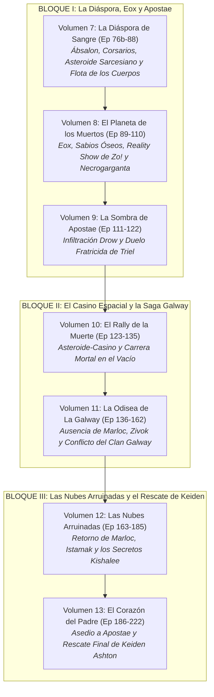

# Plan Global de Novelización: Saga Principal (Vol. 1 al 15) y Catálogo de Especiales
## Mapeo Integral de 272 Episodios de *Lasers y Dragones* frente a *Starfinder: Dead Suns*, Spin-offs y Especiales

> **Proyecto:** *Lasers y Dragones: La Novela*  
> **Fuente de Audio:** Podcast Oficial de Rol en Vivo *Lasers y Dragones* (Feed RSS de Libsyn y Canal Oficial de YouTube)  
> **Campaña Troncal:** *Starfinder: Dead Suns Adventure Path* (Paizo Publishing, Libros 1 al 6) enriquecida con arcos canónicos de la mesa de juego.  
> **Material Descargado y Limpio:** 150 episodios continuos (Ep 73 al 222) en texto limpio (**1.686.839 palabras** acumuladas) listos en [`planificacion_global/transcripciones/limpias/`](file:///home/jordi/Proyectos/lasersydragones/planificacion_global/transcripciones/limpias/).

---

## 1. Visión Panorámica Global de la Saga Principal (*Starfinder: Dead Suns*)

| Libro de Paizo / Arco | Episodios Podcast | Volúmenes Literarios | Escenario Principal | Estado / Planificación |
| :--- | :---: | :---: | :--- | :---: |
| **Libro 1: Incident at Absalom Station** | 001 – 032 | **Volumen 1 y Volumen 2** | Estación Ábsalon, Roca del Drift, *Acreon* | **Publicados en PDF** |
| **Libro 2: Temple of the Twelve** | 033 – 072 | **Volúmenes 3, 4, 5 y 6** | Castrovel (Qabarat, Selvas de Ukulam, Templo) | **Publicados en PDF** |
| **Libro 3: Splintered Worlds (Parte 1)** | 076b – 088 | **Volumen 7** | Ábsalon (emboscada) y La Diáspora (asteroides) | **Planificado y Transcrito** |
| **Libro 3: Splintered Worlds (Parte 2)** | 089 – 110 | **Volumen 8** | Eox (Planeta de los Muertos, Reality Show Zo!) | **Planificado y Transcrito** |
| **Arco Canónico Propio: Casa Istrav** | 111 – 122 | **Volumen 9** | Apostae (Infiltración Drow, Duelo Fratricida) | **Planificado y Transcrito** |
| **Transición: Asteroide-Casino** | 123 – 135 | **Volumen 10** | El Casino al fin del Universo y Rally de la Muerte | **Planificado y Transcrito** |
| **Arco Canónico: Familia Galway & Zivok** | 136 – 162 | **Volumen 11** | La nave *La Galway*, clanes ysoki, ausencia Marloc | **Planificado y Transcrito** |
| **Libro 4: The Ruined Clouds** | 163 – 185 | **Volumen 12** | Nejeor e Istamak (Kishalee, Templo y Museo) | **Planificado y Transcrito** |
| **Arco Canónico: Rescate de Keiden Ashton** | 186 – 222 | **Volumen 13** | Apostae (Duelo final drow y rescate del padre) | **Planificado y Transcrito** |
| **Libro 5: The Thirteenth Gate** | 223 – 250 | **Volumen 14** | La Puerta de los Doce Soles y Mega-Ingeniería | *Proyección futura* |
| **Libro 6: Empire of Bones** | 251 – 272 | **Volumen 15** | El Degenerador Estelar y Clímax de Campaña | *Proyección futura* |

---

## 2. Catálogo de Volúmenes Especiales y Spin-offs (Fuera de Serie)

Todos los episodios que no pertenecen a la campaña principal de *Starfinder* han sido detectados, aislados y catalogados como volúmenes independientes fuera de serie:

### ❄️ ESPECIAL 1: *Hielo y Sangre (HyS)* (22 Episodios)
* **Fecha de Emisión:** 29 de abril de 2020 a 23 de septiembre de 2020.
* **Contexto de la Mesa:** Pausa obligada en la historia principal de Starfinder (entre el Episodio 17 y el 18) provocada por el confinamiento inicial de la pandemia de COVID-19. La mesa decidió jugar en remoto a través de Discord una campaña completa e improvisada para no comprometer la calidad de audio de la saga espacial.
* **Sistema de Juego:** *Pathfinder 2e* (utilizado por primera vez en el canal).
* **Ambientación y Trama:** El Gran Imperio Dreki. Una fantasía medieval cruda ambientada en páramos helados donde los protagonistas inician como prisioneros encadenados en el siniestro *Peñón de la Pena* y deben abrirse paso hacia la libertad o la tumba en medio de la nieve.
* **Mesa de Juego:** Roberto (GM), Irene, Sofía, Miguel y Juan Pablo.

---

### 🌲 ESPECIAL 2: *Mundo de Oscuridad (MdO) - La Caída de Piedra de Plaga* (48 Episodios)
* **Fecha de Emisión:** 21 de septiembre de 2022 a 30 de agosto de 2023.
* **Contexto de la Mesa:** Pausa de exactamente un año en Starfinder tras el impactante cierre del primer arco de Apostae (Episodio 120), antes de reanudar en septiembre de 2023 (Episodio 121).
* **Sistema de Juego:** *Pathfinder 2e* adaptando la aventura oficial de Paizo Publishing: *The Fall of Plaguestone* (*La Caída de Piedra de Plaga*).
* **Ambientación y Trama:** El pueblo aparentemente tranquilo de Piedra de Plaga (*Plaguestone*), asolado por misteriosos asesinatos, criaturas mutadas, alquimia prohibida y la amenaza de Vilree.
* **Mesa de Juego:** Roberto (GM), Irene, Sofía, Miguel y Juan Pablo.

---

### 🎃 ESPECIAL 3: *Spooky Octubre 2021: Pesadilla en el Viejo Golarion* (4 Episodios)
* **Episodios:** 73 al 76 (primera mitad).
* **Sistema de Juego:** *Pathfinder 2e* dentro del universo de Starfinder.
* **Trama:** Aventura de Halloween donde la tripulación se sumerge en una cámara de inmersión virtual en la Estación Ábsalon (*«Aventuras en Viejo Golarion»* de la corporación EPIX).
* **Personajes Cómicos:** Benray como la rana druida *Isopi Flower*, Marloc como el orco *Valor con Bigote Sangrienta*, Axel como la leshy *Pastinaxcel 42* y Triel como la mutante *Monstruo*.

---

### 💀 ESPECIAL 4: *Spooky Octubre 2025: La Trilogía de la Muerte* (3 Episodios)
* **Fecha de Emisión:** 01 al 15 de octubre de 2025.
* **Episodios:** Partes 1, 2 y 3 (*Visiones de Verano*, *El Brindis de la Muerte*, *La Danza de la Muerte*).
* **Sistema de Juego:** *Shadowdark RPG* (sistema OSR de horror y exploración de mazmorras con antorchas a tiempo real).
* **Mesa y Jugadora Invitada:** Roberto (GM), Irene, Sofía, Miguel, Juan Pablo y la **jugadora invitada especial Daneris** (incorporada a la mesa por petición popular de la comunidad).

---

### 🕯️ ESPECIAL 5: *Spooky Octubre 2026: La Guardia de Medianoche* (Episodio 1+)
* **Fecha de Emisión:** 21 de octubre de 2026 en adelante.
* **Trama:** Nueva entrega anual de terror donde un oscuro grupo de criaturas debe cumplir una misión nocturna suicida para el Imperio.

---

## 3. Delimitación de los Volúmenes Principales (Volúmenes 7 al 13)

---

### Detalle de los Nuevos Volúmenes Planificados (10 al 13)

#### 🎲 VOLUMEN 10: *El Rally de la Muerte en el Asteroide-Casino* (Episodios 123 al 135)
* **Episodios:** 123 al 135 (13 episodios / ~12 capítulos).
* **Mapeo:** Transición hacia el Libro 4 de Paizo / Aventura de mesa en el límite del espacio civilizado.
* **Sinopsis:** Con la necesidad de reparar su nave y limpiar fondos tras su fuga de Apostae, la tripulación arriba al legendario asteroide-casino. Entre timbas intergalácticas, robots de protocolo corruptos y apuestas ilegales, se inscriben en el despiadado "Rally de la Muerte": una carrera vehicular extrema a través de campos de minas y fuego cruzado en el vacío espacial donde Marloc ejerce de piloto estelar antes de tomar una decisión que cambiará el destino del grupo.

#### 🐀 VOLUMEN 11: *La Odisea de La Galway* (Episodios 136 al 162)
* **Episodios:** 136 al 162 (27 episodios / ~16-18 capítulos).
* **Notas de Mesa Vitales:** En el Episodio 136, **Juan Pablo decide dar un receso temporal a Marloc Boosmar** para probar una nueva clase e introduce al operativo **Zivok**. Durante este largo viaje, **Marloc permanece fuera de juego o es llevado puntualmente por Roberto como PNJ**.
* **Sinopsis:** A bordo del crucero familiar *La Galway*, Benray se enfrenta a las deudas de honor y vendettas de su clan ysoki. Junto a parientes impredecibles como Yolmar, Valentina, Gazit y Rinrey, la tripulación sufre semanas de claustrofobia, emboscadas y abordajes en la oscuridad del espacio profundo mientras Zivok se gana la confianza del equipo.

#### ☁️ VOLUMEN 12: *Las Nubes Arruinadas: La Ciudadela de Istamak* (Episodios 163 al 185)
* **Episodios:** 163 al 185 (23 episodios / ~16 capítulos).
* **Mapeo Oficial:** ***Starfinder: Dead Suns - Libro 4: The Ruined Clouds***.
* **Notas de Mesa Vitales:** En el Episodio 163 (*"Si te he Fallado te Pido Perdón"*), **se produce el esperado retorno de Juan Pablo y Marloc Boosmar a la tripulación**.
* **Sinopsis:** Tras el emotivo reencuentro con Marloc, la *Estrella Errante* penetra en la densa atmósfera tóxica del planeta Nejeor. Descubren la fabulosa ciudad flotante de Istamak, habitada por los degenerados descendientes de los Kishalee. Entre el asedio de bestias micóticas y la exploración del gigantesco Museo de Istamak, los héroes reactivan las antiguas inteligencias artificiales para descubrir la ubicación de la legendaria Puerta Estelar que conduce a la Superarma.

#### 🗡️ VOLUMEN 13: *El Corazón del Padre: La Redención de Apostae* (Episodios 186 al 222)
* **Episodios:** 186 al 222 (37 episodios / ~20 capítulos).
* **Mapeo:** *Arco Canónico Propio de la Mesa (Clímax de la Casa Istrav y Keiden Ashton)*.
* **Sinopsis:** Triel descubre que su padre, el humano Keiden Ashton, no murió en el pasado: está prisionero en las mazmorras más profundas de la nobleza drow, torturado y agonizante. La tripulación ejecuta un asalto a gran escala contra los dominios de la Casa Istrav. Tras una guerra de guerrillas en la oscuridad subterránea, Triel derrota a la jerarquía matriarcal y rescata a su padre biológico en un clímax desgarrador que sella para siempre las heridas de su infancia.

---

## 4. Estructura de Metadatos y Recursos en el Proyecto

Todos los recursos se encuentran organizados y vinculados en el repositorio dentro de [`planificacion_global/`](file:///home/jordi/Proyectos/lasersydragones/planificacion_global/):
1. **Plan Detallado de Episodios (Volúmenes 7 al 13):**
   * [`PLAN_DETALLADO_VOLUMENES_7_A_13.md`](file:///home/jordi/Proyectos/lasersydragones/planificacion_global/PLAN_DETALLADO_VOLUMENES_7_A_13.md) (tabla completa y detallada episodio por episodio de los 150 capítulos procesados).
2. **Metadatos de la Saga Troncal:**
   * [`planificacion_global/metadatos/episodios_starfinder_73_222.json`](file:///home/jordi/Proyectos/lasersydragones/planificacion_global/metadatos/episodios_starfinder_73_222.json) (Catálogo maestro consolidado de 150 episodios).
   * [`planificacion_global/metadatos/episodios_starfinder_73_122.json`](file:///home/jordi/Proyectos/lasersydragones/planificacion_global/metadatos/episodios_starfinder_73_122.json) (50 episodios).
   * [`planificacion_global/metadatos/episodios_starfinder_123_222.json`](file:///home/jordi/Proyectos/lasersydragones/planificacion_global/metadatos/episodios_starfinder_123_222.json) (100 episodios).
3. **Metadatos de Especiales y Spin-offs:**
   * [`planificacion_global/metadatos/especiales_y_spinoffs.json`](file:///home/jordi/Proyectos/lasersydragones/planificacion_global/metadatos/especiales_y_spinoffs.json) (HyS: 22 eps, MdO: 48 eps, Spooky Octubre 2021, 2025 y 2026).
4. **Transcripciones Limpias en Texto Corrido:**
   * 150 archivos continuos en [`planificacion_global/transcripciones/limpias/`](file:///home/jordi/Proyectos/lasersydragones/planificacion_global/transcripciones/limpias/) (**1.686.839 palabras**).

