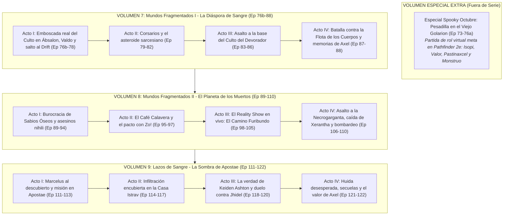

# Plan Editorial de Novelización: Volúmenes 7, 8, 9 y Especial Extra
## Mapeo Integral de Episodios (73 al 122) frente a *Starfinder: Dead Suns*, Arcos de Mesa y Especiales

> **Proyecto:** *Lasers y Dragones: La Novela*  
> **Fuente de Audio:** Podcast Oficial de Rol en Vivo *Lasers y Dragones* (Feed RSS de Libsyn y Canal de YouTube)  
> **Campaña Base:** *Starfinder: Dead Suns Adventure Path* (Paizo Publishing) enriquecida con subtramas canónicas de la mesa de juego  
> **Estado:** 50 episodios transcritos y limpios (541.511 palabras en total) en `planificacion_volumenes_7_10/`

---

## 1. Visión Panorámica: Mapeo de la Campaña Completa y Especiales

| Bloque / Libros de *Dead Suns* | Episodios Podcast | Volúmenes Literarios | Escenario Principal | Naturaleza / Estado |
| :--- | :---: | :---: | :--- | :---: |
| **Libro 1: Incident at Absalom Station** | 001 – 032 | **Vol. 1 y Vol. 2** | Estación Ábsalon, Roca del Drift, *Acreon* | **Saga Principal (Completados)** |
| **Libro 2: Temple of the Twelve** | 033 – 072 | **Vol. 3, 4, 5 y 6** | Castrovel (Qabarat, Selvas de Ukulam, Templo) | **Saga Principal (Completados)** |
| **Especial Halloween (Meta-Rol en Golarion)** | 073 – 076 | **Volumen Especial Extra** | Simulación virtual en Ábsalon (*Pathfinder 2e*) | **Volumen Extra Independiente** |
| **Libro 3: Splintered Worlds (Parte 1)** | 076b – 088 | **Volumen 7** | Ábsalon (emboscada del Culto) y La Diáspora | **Saga Principal (Listo para redactar)** |
| **Libro 3: Splintered Worlds (Parte 2)** | 089 – 110 | **Volumen 8** | Eox (Planeta de los Muertos, Reality Show, Necrogarganta) | **Saga Principal (Listo para redactar)** |
| **Arco Canónico Propio: Casa Istrav** | 111 – 122 | **Volumen 9** | Apostae (Fortaleza Drow, Duelo de Triel vs Jhidel) | **Saga Principal (Listo para redactar)** |
| **Libro 4: The Ruined Clouds** | 123 – 160+ | **Volumen 10+** | Casino Espacial, Rally mortal, Nejeor e Istamak | **Saga Principal (Futura planificación)** |

---

## 2. Propuesta Editorial de Delimitación y Estructura

Siguiendo las pautas de la skill [novelizacion-lasers-y-dragones](../.agents/skills/novelizacion-lasers-y-dragones/SKILL.md), separamos limpiamente el contenido lúdico fuera de serie de la trama principal de ciencia ficción:

---

### 🎃 VOLUMEN ESPECIAL EXTRA: *Spooky Octubre: Pesadilla en el Viejo Golarion*
* **Naturaleza:** Volumen Especial Extra / Spin-Off Fuera de Serie (independiente de la numeración principal de *Dead Suns*).
* **Episodios:** 73 al 76 (primera mitad).
* **Mapeo:** *Especial temático de Halloween de la mesa de juego (reglas de Pathfinder 2e en Viejo Golarion)*.
* **Sinopsis Argumental:**  
  Tras la intensa y asfixiante expedición por las selvas de Ukulam en Castrovel, la tripulación de la *Estrella Errante* decide tomarse un respiro en la Estación Ábsalon aceptando una invitación exclusiva de la corporación EPIX para probar su módulo de inmersión total neural: *«Aventuras en Viejo Golarion»*. Sumergidos en cápsulas sensoriales, sus conciencias son transferidas a un universo de fantasía medieval gótica con avatares extravagantes: Benray es una rana druida (*Isopi Flower*), Marloc un brutal orco guerrero con bigote (*Valor con Bigote Sangrienta*), Axel una tierna pero letal hortaliza leshy (*Pastinaxcel 42*) y Triel una barda mutante atormentada con tentáculos (*Monstruo*). Juntos deberán resolver los misterios del tenebroso pueblo de Durham, explorar ruinas de castillos quemados, lidiar con posadas "bugueadas", derrotar horrores no-muertos y vencer al temible Damien en una hilarante y terrorífica partida de rol dentro del rol.
* **Estructura Literaria:** 4 capítulos ágiles y cargados de humor meta-referencial, parodia de tropos de rol de mesa y homenaje a *Pathfinder 2e*.

---

### 📕 VOLUMEN 7: *Mundos Fragmentados I: La Diáspora de Sangre*
* **Naturaleza:** Saga Principal (Tomo 7).
* **Episodios:** 76 (segunda mitad) al 88 (~13 episodios de podcast / ~12-14 capítulos de novela).
* **Mapeo:** *Dead Suns Libro 3 (Parte 1: The Diaspora)* + Secuelas en Ábsalon.
* **Apertura y Recomendación Editorial:**  
  La novela prescinde de narrar la partida medieval completa y **arranca de lleno en el mundo real**: los personajes despiertan en paños menores de los tanques de inmersión en la Estación Ábsalon para descubrir que la invitación era una trampa letal del Culto del Devorador («El Coro») para secuestrarlos y torturarlos por la información clasificada de Castrovel.
* **Sinopsis Argumental:**  
  Al despertar en la Estación Ábsalon, los aventureros se ven atrapados en un asalto armado: mercenarios *gnolls* taladran los accesos blindados mientras un heroico ingeniero halfling, **Valdo**, los asiste desde los conductos de ventilación. Al salir del trance, Marloc experimenta una trascendental visión cósmica donde las constelaciones le susurran sobre la mística «esfera jerarca» de su padre Ambrose. Tras neutralizar a los asaltantes, interrogar a la cultista y enviar un holomensaje encriptado a la estrella de rock **Syd Velch** sobre Null-9, Triel recibe una emotiva despedida clandestina del Oficial León, quien le regala un cuervo de madera sagrada y le anuncia su propio traslado a La Diáspora.  
  Poniendo proa al hiperespacio del Drift, la *Estrella Errante* llega al caótico cinturón de asteroides de La Diáspora. Entre corsarios espaciales de los Capitanes Libres, cavernas en gravedad cero repletas de vampiros plateados y el asalto a un templo sarcesiano convertido en bastión fanático del Devorador, el equipo libra un feroz combate naval a quemarropa contra un destructor de la Flota de los Cuerpos (*Corpse Fleet*), que despierta dolorosas memorias de los chasis anteriores de Axel 42 y marca el rumbo hacia el mundo de los no-muertos: Eox.
* **Estructura en 4 Actos:**
  * **Acto I (Ep 76b-78):** *El Despertar de la Emboscada.* Ruptura del trance en Ábsalon, tiroteo contra los gnolls, rescate de Valdo, visión estelar de Marloc, interrogatorio de la cultista, despedida íntima de Triel con León y salto al Drift.
  * **Acto II (Ep 79-82):** *El Cinturón de los Piratas.* Llegada a La Diáspora, tensión con los Capitanes Libres y descenso al asteroide sarcesiano habitado por aberraciones y vampiros de plata.
  * **Acto III (Ep 83-86):** *El Espinazo del Vacío.* Infiltración en la base subterránea del Culto del Devorador, combate contra la bestia guardiana, asalto al templo y hackeo de coordenadas hacia Eox.
  * **Acto IV (Ep 87-88):** *Flota de Huesos.* Batalla naval en el vacío contra la Flota de los Cuerpos (*Corpse Fleet*), memorias fragmentadas de Axel y rumbo a Eox.

---

### 💀 VOLUMEN 8: *Mundos Fragmentados II: El Planeta de los Muertos*
* **Naturaleza:** Saga Principal (Tomo 8).
* **Episodios:** 89 al 110 (22 episodios de podcast / ~16-18 capítulos de novela).
* **Mapeo:** *Dead Suns Libro 3 (Parte 2: Eox - The Planet of the Dead & The Necrogorge)*.
* **Sinopsis Argumental:**  
  La tripulación desciende sobre Eox, un mundo árido y radiactivo donde la vida biológica es considerada una debilidad frágil por los Sabios Óseos (*Bone Sages*). Atrapados en una burocracia mortal y acechados por asesinos nihilistas (*nihili*), los aventureros acuden al infame Café Calavera en busca de la nigromante renegada Xerantha Zatus. La pista los conduce al magnate mediático no-muerto Zo!, quien les exige convertirse en concursantes de su *reality show* de supervivencia extrema: una carnicería televisada en los desiertos subterráneos, perseguidos por un Golem de Neutrones en "El Camino Furibundo". Tras ganar a la audiencia de cadáveres, asaltan la inexpugnable Necrogarganta para enfrentarse a un guardián dragonkin, al colosal Ellicoth esquelético ("Ellicujo") y a la propia Xerantha, huyendo in extremis bajo un bombardeo aéreo de la Flota de los Cuerpos. **(Clímax y cierre del Libro 3 de Dead Suns)**.
* **Estructura en 4 Actos:**
  * **Acto I (Ep 89-94):** *Trámites de Ultratumba.* Fantasmas en la nave, atmósfera tóxica de Orphys, trámites en el Ministerio de los Vivos y emboscada de asesinos nihili.
  * **Acto II (Ep 95-97):** *El Café Calavera.* Infiltración en el antro de los no-muertos, contacto con los agentes de Zo! y la firma del contrato televisivo.
  * **Acto III (Ep 98-105):** *El Show Mortal de Zo!* El coliseo subterráneo, la carrera mortal "El Camino Furibundo", choque contra el Golem de Neutrones y traición de rivales.
  * **Acto IV (Ep 106-110):** *La Caída de Xerantha Zatus.* Incursión en la Necrogarganta, pacto con el Dragonkin, combate contra el Ellicoth, ajusticiamiento de Xerantha y escape orbital.

---

### 🕸️ VOLUMEN 9: *Lazos de Sangre: La Sombra de Apostae*
* **Naturaleza:** Saga Principal (Tomo 9).
* **Episodios:** 111 al 122 (12 episodios de podcast / ~12 capítulos de novela).
* **Mapeo:** *Arco Canónico Exclusivo de la Mesa de Juego (Inversiones Estelares S.C., Marcelus y la Casa Istrav en Apostae)*.
* **Sinopsis Argumental:**  
  Apenas escapan con vida de Eox, el temido directivo corporativo Marcelus se manifiesta en persona para cobrar sus deudas y revelar los oscuros hilos que unen a Inversiones Estelares S.C. con la alta nobleza drow. Para descubrir el secreto de su linaje y la verdad sobre su padre desaparecido, el corsario humano Keiden Ashton, Triel lidera una misión suicida: infiltrar a toda la tripulación disfrazada de servidumbre doméstica en la fortaleza de la influyente **Casa Istrav**. Entre pasadizos secretos, venenos aristocráticos y sospechas continuas, Triel descubre la traición de su madre drow y libra un feroz duelo fratricida a muerte contra su hermanastra, Jhidel Istrav.
* **Estructura en 4 Actos:**
  * **Acto I (Ep 111-113):** *El Rostro de Marcelus.* Confrontación directa con el mecenas corporativo, expedientes confidenciales y rumbo a Apostae.
  * **Acto II (Ep 114-117):** *La Servidumbre de la Araña.* Contacto con la orcriada e infiltración encubierta como sirvientes en la opulenta mansión Istrav.
  * **Acto III (Ep 118-120):** *Duelo de Hermanas.* Robo de los archivos de sangre, la desgarradora verdad sobre Keiden Ashton y combate a muerte entre Triel y Jhidel.
  * **Acto IV (Ep 121-122):** *Cicatrices y Redención.* Huida desesperada de Apostae hacia Thanox, curación de heridas y el heroísmo de Axel 42.

---

## 3. Catálogo Completo y Mapeo Episodio por Episodio (73 al 122)

| Ep | Título Oficial | Fecha Emisión | Libro Starfinder / Subtrama | Asignación Editorial | Síntesis Argumental |
| :-: | :--- | :-: | :--- | :-: | :--- |
| **073** | Spooky Octubre: El Pueblo Maldito | 20/10/2021 | Especial Halloween / Meta-Rol | **Volumen Especial Extra** | Entrada en la simulación virtual de EPIX. Creación de avatares medievales y pueblo de Durham. |
| **074** | Spooky Octubre: El Castillo del Mal | 27/10/2021 | Especial Halloween / Meta-Rol | **Volumen Especial Extra** | Exploración del castillo quemado, trampas y horrores góticos en la simulación de *Pathfinder 2e*. |
| **075** | Spooky Octubre: La Bodeguita del Terror | 03/11/2021 | Especial Halloween / Meta-Rol | **Volumen Especial Extra** | Enfrentamiento en los sótanos contra aberraciones; combate lúdico contra el mal. |
| **076** | Aquí está su Premio | 10/11/2021 | Bisagra: Fin Especial / Despertar | **Vol. Especial / Vol. 7** | *Parte A:* Fin del juego y muerte de Damien. / *Parte B:* Despertar en Ábsalon, asalto de gnolls y visión de Marloc. |
| **077** | Null-ca lo hubiera imaginado | 17/11/2021 | Transición Ábsalon / Null-9 | **Volumen 7** | Interrogatorio a la cultista, acuerdo con EPIX, mensaje a Syd Velch y despedida de León con Triel. |
| **078** | Peligro es mi segundo nombre | 24/11/2021 | Transición / Salto al Drift | **Volumen 7** | Aprovisionamiento de la *Estrella Errante*, puesta a punto y salto hiperespacial a La Diáspora. |
| **079** | Corazón Pirateado | 01/12/2021 | Dead Suns 3: La Diáspora | **Volumen 7** | Llegada a La Diáspora y tenso encuentro en el vacío con piratas corsarios de los Capitanes Libres. |
| **080** | Sarcesinato en el Asteroide | 08/12/2021 | Dead Suns 3: La Diáspora | **Volumen 7** | Exploración en gravedad cero del asteroide habitado por sarcesianos. |
| **081** | Guardería: Vampiritos de Plata | 15/12/2021 | Dead Suns 3: La Diáspora | **Volumen 7** | Batalla en cavernas contra enjambres de bestias hematófagas plateadas. |
| **082** | No Puedo Sacarte de Mi Mente | 22/12/2021 | Dead Suns 3: La Diáspora | **Volumen 7** | Ataque psíquico que perturba la mente de Triel al borde de un abismo. |
| **083** | Bienvenidos al Hoyito del Diablo | 29/12/2021 | Dead Suns 3: Base del Culto | **Volumen 7** | Penetración en la compleja estructura subterránea del Culto del Devorador. |
| **084** | Si las Miradas Mataran | 05/01/2022 | Dead Suns 3: Base del Culto | **Volumen 7** | Superación de trampas arcanas y emboscadas de fanáticos en los túneles. |
| **085** | El Espinazo del Devorador | 12/01/2022 | Dead Suns 3: Base del Culto | **Volumen 7** | Combate decisivo contra la aberración guardiana del Culto del Devorador. |
| **086** | El Templo de la Puñalada | 19/01/2022 | Dead Suns 3: Base del Culto | **Volumen 7** | Hackeo de terminales sagradas: se descubren las coordenadas de Eox. |
| **087** | El Secreto de la Caja | 26/01/2022 | Dead Suns 3: Corpse Fleet | **Volumen 7** | Combate naval a quemarropa contra naves de guerra de la Flota de los Cuerpos. |
| **088** | Fantasmas del Pasado | 02/02/2022 | Dead Suns 3: Memorias de Axel | **Volumen 7** | Revelación de memorias fragmentadas de Axel 42 y sus 5 modelos anteriores. |
| **089** | Promesas | 09/02/2022 | Transición Eox / La Nave | **Volumen 8** | Manifestación del fantasma de la *Estrella Errante* y promesa de Benray. |
| **090** | Más Allá de las Estrellas | 16/02/2022 | Transición Eox / Marloc | **Volumen 8** | Marloc sufre visiones de su difunta esposa Ángela; fijación de rumbo a Eox. |
| **091** | ¡Un Planeta para Morirse! | 23/02/2022 | Dead Suns 3: Eox | **Volumen 8** | Descenso en la atmósfera letal de Eox, paisaje de necrópolis y shock biológico. |
| **092** | Trámites Muertocráticos | 02/03/2022 | Dead Suns 3: Eox | **Volumen 8** | Burocracia extrema en el Ministerio de Asuntos de los Vivos con los Sabios Óseos. |
| **093** | Antes Muerta que Sencilla | 09/03/2022 | Dead Suns 3: Eox | **Volumen 8** | Investigación de la soldada de huesos y la frialdad de la sociedad necrocrática. |
| **094** | La Debilidad de la Carne | 16/03/2022 | Dead Suns 3: Eox | **Volumen 8** | Registro del departamento abandonado; indicios de conspiración con el Devorador. |
| **095** | Calaveras y Gnomitos | 23/03/2022 | Dead Suns 3: Eox | **Volumen 8** | Emboscada salvaje de asesinos *nihili* (no-muertos del vacío espacial). |
| **096** | El Café Calavera | 30/03/2022 | Dead Suns 3: Eox | **Volumen 8** | Entrada en el antro de ocio macabro donde los cadáveres contemplan a los vivos. |
| **097** | ¡No Hay Respeto! | 06/04/2022 | Dead Suns 3: Eox | **Volumen 8** | Fricción en el Café Calavera; contacto inicial con los emisarios del productor Zo!. |
| **098** | Como Caído del Cielo | 13/04/2022 | Dead Suns 3: Zo! Reality | **Volumen 8** | Descenso a los gigantescos estudios de televisión subterráneos de Zo!. |
| **099** | El Baile de la Bolita | 20/04/2022 | Dead Suns 3: Zo! Reality | **Volumen 8** | Inicio del retorcido concurso televisado en vivo para la audiencia no-muerta. |
| **100** | El Corazón del Ratón | 27/04/2022 | Dead Suns 3: Zo! Reality | **Volumen 8** | Benray asume el protagonismo mediático y salva a un rival en un dilema moral. |
| **101** | Por la Grasa de Dios | 04/05/2022 | Dead Suns 3: Zo! Reality | **Volumen 8** | Duelo contra un cazador invisible y casi indestructible en el plató de pruebas. |
| **102** | El Camino Furibundo | 11/05/2022 | Dead Suns 3: Zo! Reality | **Volumen 8** | Inicio de la brutal persecución urbana y escape del imparable Golem de Neutrones. |
| **103** | El Camino Furibundo - Parte II | 18/05/2022 | Dead Suns 3: Zo! Reality | **Volumen 8** | Clímax de la carrera mortal en los sets de Zo!; combates sobre vehículos. |
| **104** | Érase una Vez un Puerco | 25/05/2022 | Dead Suns 3: Zo! Reality | **Volumen 8** | Asedio en el edificio final de la transmisión con todos los muertos observando. |
| **105** | Caída de Gracia | 01/06/2022 | Dead Suns 3: Zo! Reality | **Volumen 8** | Traición de los aliados en el concurso, victoria televisada y entrega de pistas. |
| **106** | Una Segunda Oportunidad | 08/06/2022 | Dead Suns 3: Necrogarganta | **Volumen 8** | Rumbo a la Necrogarganta; encuentro tenso y pacto de no agresión con el Dragonkin. |
| **107** | ¿Cómo está el arroz? | 15/06/2022 | Dead Suns 3: Necrogarganta | **Volumen 8** | Teoremas cósmicos de Marloc y reconocimiento táctico del bastión de Xerantha. |
| **108** | La Coleccionista de Huesos | 22/06/2022 | Dead Suns 3: Necrogarganta | **Volumen 8** | Infiltración en la siniestra mansión-laboratorio de la sabio óseo Xerantha Zatus. |
| **109** | Ellicujo el Perro Asesino | 29/06/2022 | Dead Suns 3: Necrogarganta | **Volumen 8** | Batalla desesperada contra la gigantesca bestia Ellicoth convertida en guardián. |
| **110** | Carta de Despido | 06/07/2022 | Dead Suns 3: Clímax Libro 3 | **Volumen 8** | Ajusticiamiento de Xerantha, robo de datos estelares y escape bajo bombardeo aéreo. |
| **111** | It's Morbin Time | 13/07/2022 | Arco Canónico: Marcelus | **Volumen 9** | Marcelus aparece en persona para cobrar cuentas y desvelar secretos corporativos. |
| **112** | ¿Quién es el Jefe? | 20/07/2022 | Arco Canónico: Marcelus | **Volumen 9** | Revelación de la red Inversiones Estelares S.C. y la implicación de la nobleza drow. |
| **113** | Juego de Niños | 27/07/2022 | Arco Canónico: Apostae | **Volumen 9** | Travesía hacia el mundo fortaleza de Apostae y preparación de la tapadera. |
| **114** | Lo que Oculta la Orcriada | 03/08/2022 | Arco Canónico: Apostae | **Volumen 9** | Contacto con una sirvienta orca que conoce los pasadizos de la Casa Istrav. |
| **115** | El Nido de la Araña | 10/08/2022 | Arco Canónico: Apostae | **Volumen 9** | Infiltración encubierta en el bastión de la aristocracia drow. |
| **116** | Servidumbre con Pesadumbre | 17/08/2022 | Arco Canónico: Apostae | **Volumen 9** | La tripulación disfrazada de sirvientes sufre la crueldad y sospechas de las drow. |
| **117** | Babitas pa' que las Quiero | 24/08/2022 | Arco Canónico: Apostae | **Volumen 9** | Benray queda aislado y desarmado en los aposentos nobles; ingenio para zafar. |
| **118** | Naves de Sangre | 31/08/2022 | Arco Canónico: Apostae | **Volumen 9** | Acceso al archivo genealógico: secretos de la madre de Triel y Keiden Ashton. |
| **119** | Amor Fraternal | 07/09/2022 | Arco Canónico: Apostae | **Volumen 9** | Confrontación directa y odio desatado entre Triel y su hermanastra Jhidel Istrav. |
| **120** | Todo Sobre Mi Madre | 14/09/2022 | Arco Canónico: Apostae | **Volumen 9** | Duelo fratricida a muerte, victoria de Triel y escape bajo alarma general. |
| **121** | Siempre nos quedará Thanox | 06/09/2023 | Arco Canónico: Epílogo | **Volumen 9** | Huida hacia el planeta Thanox, curación de heridas y balance emocional. |
| **122** | El verdadero valor de A.xel | 13/09/2023 | Arco Canónico: Epílogo | **Volumen 9** | Reafirmación del compromiso y humanidad de Axel 42 frente a sus compañeros. |

---

## 4. Recursos Disponibles en el Repositorio

1. **Metadatos Completos:**  
   Archivo [`planificacion_volumenes_7_10/metadatos/episodios_73_122.json`](./metadatos/episodios_73_122.json) con enlaces de audio de Libsyn, IDs de YouTube, sinopsis purgadas y clasificación narrativa.
2. **Transcripciones Raw (VTT):**  
   50 archivos en [`planificacion_volumenes_7_10/transcripciones/raw/`](./transcripciones/raw/) con subtítulos de YouTube en español.
3. **Transcripciones Limpias Deduplicadas:**  
   50 archivos de texto continuo en [`planificacion_volumenes_7_10/transcripciones/limpias/`](./transcripciones/limpias/) (541.511 palabras) listos para la novelización directa.
4. **Script Reproducible:**  
   Script [`planificacion_volumenes_7_10/scripts/descargar_y_procesar_73_122.py`](./scripts/descargar_y_procesar_73_122.py) para regenerar o ampliar lotes futuros.
